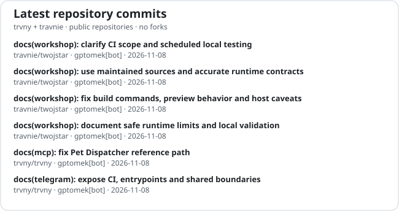

# twojstar
## TWÓJ STARY INCORPORATED™

**Open source under one roof: apps, feeds, media, automation, and small machines that somehow became infrastructure.**

   

 

[Polski](README_pl.md) · **English** · [简体中文](README_zh.md)

 

  
  

### 🧭 Project map

| project | home | what lives there |
| --- | --- | --- |
| 🚗 **Autka** | [`travnie/Autka`](https://github.com/travnie/Autka) | Android/KMP car-listing aggregator and backend |
| 🤖 **Aistee** | [`travnie/aistee`](https://github.com/travnie/aistee) | Android workspace for account-backed and free-provider LLM access |
| 🐤 **Kanarek** | [`travnie/kanarek`](https://github.com/travnie/kanarek) | RSS/Atom reader, widgets, radio/IPTV and Worker backend |
| 📡 **Feedseek** | [`trvny/feedseek`](https://github.com/trvny/feedseek) | feed discovery, repair and generation |
| 📺 **TVPI** | [`trvny/tvpi`](https://github.com/trvny/tvpi) | IPTV tooling, web entry points and Worker bits |
| 🔊 **WAM Bridge** | [`travnie/wambridge`](https://github.com/travnie/wambridge) | Samsung Wireless Audio Multiroom bridge and foobar2000 output |
| 🧰 **Workshop** | [`travnie/twojstar`](https://github.com/travnie/twojstar) | Benches, Weather Feed, Feedboard, Xiaomi ADB Tools, Paint.NET ICO and shared rolling releases |
| 🧪 **Infra lab** | [`trvny/trvny`](https://github.com/trvny/trvny) | GitHub Apps, MCP services, experiments, automation and the cupboard where the cables live |

© trvny · bots on payroll · consolidation over fragmentation · po kolei, na spokojnie

### :bar_chart: Workshop telemetry

  
  

### Ja i moje ziomki

  

---

##

### 🔀 Open pull requests

<!--OPEN_PRS:START-->
| Repository | PR | Title | Author | State | Updated |
| --- | ---: | --- | --- | --- | --- |
| travnie/aistee | [#462](https://github.com/travnie/aistee/pull/462) | fix(web): reject stale turn navigation callbacks | @trvny | ready | 2026-11-08 |
| travnie/Autka | [#269](https://github.com/travnie/Autka/pull/269) | ci: bump the actions group with 2 updates | @dependabot[bot] | ready | 2026-11-09 |
| travnie/Autka | [#270](https://github.com/travnie/Autka/pull/270) | deps(backend): bump the backend-minor-patch group in /backend with 4 updates | @dependabot[bot] | ready | 2026-11-09 |
| travnie/Autka | [#271](https://github.com/travnie/Autka/pull/271) | deps: bump the misc-minor-patch group with 3 updates | @dependabot[bot] | ready | 2026-11-09 |
| travnie/twojstar | [#457](https://github.com/travnie/twojstar/pull/457) | feat(docbench): make Files the starting workspace | @trvny | ready | 2026-11-09 |
| travnie/wambridge | [#234](https://github.com/travnie/wambridge/pull/234) | test: measure native speaker control latency without changing playback | @trvny | draft | 2026-11-05 |
<!--OPEN_PRS:END-->

### 💬 Quote from the drawer

<!-- markdownlint-disable MD033 -->
<!--STARTS_HERE_QUOTE_README-->
<i>❝Lenovo stands for ‘new legend’. ‘Le’ for legend, and ‘novo’ stands for new.❞</i>
<!--ENDS_HERE_QUOTE_README-->
<!-- markdownlint-enable MD033 -->

### 📰 Recently on the air

<!--README_FEED:START-->
- [Trust but Verify: Implementing Frontier AI Policy in California and Beyond](https://carnegieendowment.org/research/2026/11/trust-but-verify-implementing-frontier-ai-policy-in-california-and-beyond)
- [Promises Made, Promises Unmet: The NPP’s Struggle to Reform Sri Lanka](https://carnegieendowment.org/research/2026/11/promises-made-promises-unmet-the-npps-struggle-to-reform-sri-lanka)
- [Ma go wiele telefonów. Mało kto wie, do czego służy ten otwór](https://antyweb.pl/maly-otwor-obok-gniazda-ladowania-telefonu-do-czego-sluzy)
- [Tchibo Esperto Mini: mały ekspres BEZ kapsułek, który skradł me serce](https://antyweb.pl/tchibo-esperto-mini-maly-ekspres-bez-kapsulek-ktory-skradl-me-serce)
- [O północy w Porębie Wielkiej samochód wypadł z drogi, uderzył w drzewo i dachował - Gazeta Krakowska](https://news.google.com/atom/articles/CBMiwgFBVV95cUxPSGEwTVpFRU5NQ2diQUVWVUtQVjJUUW85LU9KZXBCTEtFQnlPWk1TOW1xSl9FQUgyd1pvVWxYRjRpbXhJY3d1NXl1UXQtcVp6aHAwS1VtaTg3SEVZZXpPUHVKZmJjRXgzV1ZhR3JELUs5UUFYWktPbmRMek9PSW9TUlFtaGx4TUh5SWk3MnZIYW5sdzFlZ2R6Ry1DbG1fbGZ5SDh2R0U0WGE4aXUwaVpvTTBqQzZLT1FNQWpteGNBU08yUQ?oc=5)
- [Nocny wypadek w Rudzach k. Zatora. Pijana 17-latka Zatorzanka wypadła z jadącego samochodu - Gazeta Krakowska](https://news.google.com/atom/articles/CBMizgFBVV95cUxOQ3pZTlQ4dng5aUtJSENUMEFndnUzcGJCcUVwRVg5RXhsMjZha2o1WjZmZy0zQnB6QVNzaV9TZWFGOG05b0VDUTI3LWVveTVGdl9PNzRpbkktbHBrMGQ1ZXF5R01sbkhxblhoQkwzVnF4RUVTOTNEUFVjY2cybGY3NEhHbHQ0WkRHMUR6Z1djeEVzZDE1TVI5Y1FoNHpkTllLcndVc0pYUVVrNlFXQjJOQW1Idlg3SXJpRDdFMDdocVJEckwyR2NjMWJnR0Zvdw?oc=5)
<!--README_FEED:END-->
