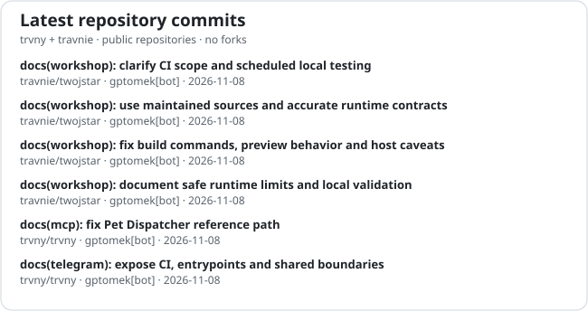

# twójstar
## TWÓJ STARY INCORPORATED™

**Open source pod jednym dachem: aplikacje, feedy, multimedia, automatyzacja i małe maszyny, które jakimś cudem stały się infrastrukturą.**

 

**Polski** · [English](README.md) · [简体中文](README_zh.md)

 

  
  

### 🧭 Mapa projektów

| projekt | dom | co tam mieszka |
| --- | --- | --- |
| 🏢 **Ustawienia organizacji** | [`.github`](https://github.com/travnie/.github) | profil, pliki społeczności, synchronizacja profilu i organizacyjna hydraulika |
| 🚗 **Autka** | [`travnie/Autka`](https://github.com/travnie/Autka) | agregator ogłoszeń samochodowych Android/KMP i backend |
| 🤖 **LlmBench** | [`travnie/llmbench`](https://github.com/travnie/llmbench) | środowisko Android do dostępu do LLM-ów przez konta i darmowych providerów |
| 🐤 **Kanarek** | [`travnie/kanarek`](https://github.com/travnie/kanarek) | czytnik RSS/Atom, widgety, radio/IPTV i backend Workera |
| 📡 **Feedseek** | [`trvny/feedseek`](https://github.com/trvny/feedseek) | wykrywanie, naprawianie i generowanie feedów |
| 📺 **TVPI** | [`trvny/tvpi`](https://github.com/trvny/tvpi) | narzędzia IPTV, webowe punkty wejścia i kawałki Workera |
| 🔊 **WAM Bridge** | [`travnie/wambridge`](https://github.com/travnie/wambridge) | most dla Samsung Wireless Audio Multiroom i wyjście foobar2000 |
| 🧰 **Warsztat** | [`travnie/twojstar`](https://github.com/travnie/twojstar) | Benche, Weather Feed, Feedboard, Xiaomi ADB Tools, Paint.NET ICO i wspólne rolling release’y |
| 🧪 **Lab infrastruktury** | [`trvny/trvny`](https://github.com/trvny/trvny) | GitHub Apps, usługi MCP, eksperymenty, automatyzacja i szafka, w której mieszkają kable |

© trvny · boty na liście płac · konsolidacja zamiast fragmentacji · po kolei, na spokojnie

### :bar_chart: Workshop telemetry

  
  

### Ja i moje ziomki

  

---

##

### 🔀 Otwarte pull requesty

<!--OPEN_PRS:START-->
| Repozytorium | PR | Tytuł | Autor | Stan | Aktualizacja |
| --- | ---: | --- | --- | --- | --- |
| travnie/aistee | [#462](https://github.com/travnie/aistee/pull/462) | fix(web): reject stale turn navigation callbacks | @trvny | gotowy | 2026-11-07 |
| travnie/aistee | [#463](https://github.com/travnie/aistee/pull/463) | ci: bump the actions group with 2 updates | @dependabot[bot] | gotowy | 2026-11-07 |
| travnie/aistee | [#464](https://github.com/travnie/aistee/pull/464) | deps: bump the gradle-minor-patch group with 5 updates | @dependabot[bot] | gotowy | 2026-11-07 |
| travnie/wambridge | [#234](https://github.com/travnie/wambridge/pull/234) | test: measure native speaker control latency without changing playback | @trvny | wersja robocza | 2026-11-05 |
<!--OPEN_PRS:END-->

### 💬 Cytat z szuflady

<!-- markdownlint-disable MD033 -->
<!--STARTS_HERE_QUOTE_README-->
<i>❝Impossible is a word to be found only in the dictionary of fools. — Napoleon Bonaparte❞</i>
<!--ENDS_HERE_QUOTE_README-->
<!-- markdownlint-enable MD033 -->

### 📰 Ostatnio na antenie

<!--README_FEED:START-->
- [Trust but Verify: Implementing Frontier AI Policy in California and Beyond](https://carnegieendowment.org/research/2026/11/trust-but-verify-implementing-frontier-ai-policy-in-california-and-beyond)
- [Promises Made, Promises Unmet: The NPP’s Struggle to Reform Sri Lanka](https://carnegieendowment.org/research/2026/11/promises-made-promises-unmet-the-npps-struggle-to-reform-sri-lanka)
- [Jade Benning's Final Call | Post Mortem](https://www.cbsnews.com/video/110726-48-hours-post-mortem-episode-3/)
- [The pros and cons of using an Amazfit smartwatch](https://www.engadget.com/2306820/using-amazfit-smartwatch-pros-and-cons/)
- [This week on "Sunday Morning" \(Nov. 8\)](https://www.cbsnews.com/news/this-week-on-sunday-morning-nov-8-2026/)
- [Detroit Lions Reveal Uniform Combo for Matchup vs. Miami](https://sports.yahoo.com/articles/detroit-lions-reveal-uniform-combo-231038067.html)
<!--README_FEED:END-->
